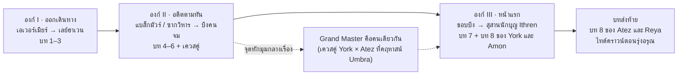

# Narrative Design — Grid Dungeon d20

> ต่อจาก `world-and-character-lore.md` เอกสารนี้ตอบว่าเรื่องจะถูกเล่า **อย่างไร** ให้มีผลกระทบทางอารมณ์ และไหลลื่นในเกม roguelike ที่ผู้เล่นตายและเริ่มใหม่ซ้ำหลายสิบรอบ
>
> ส่วนที่ติด **[เสนอ]** คือโครงเรื่องที่เพิ่มขึ้นมาใหม่ ส่วนที่เหลือต่อยอดจาก Canon

---

## 1. คำถามหลักของเรื่อง

**"ความช่วยเหลือยังคุ้มค่าอยู่ไหม เมื่อมันมีราคาที่ต้องจ่าย"**

ตัวละครทุกตัวตอบคำถามนี้ต่างกัน และคำตอบเปลี่ยนไปตามเรื่อง

| ตัวละคร | เชื่ออะไรตอนเริ่ม | สิ่งที่ท้าทายความเชื่อ | เชื่ออะไรตอนจบ |
| --- | --- | --- | --- |
| York'Runn | การช่วยเหลือคือหน้าที่ ถ้าแข็งแกร่งพอจะช่วยได้ทุกคน | วิหารล่มเพราะอาจารย์เลือกช่วยคนอื่น | ช่วยทุกคนไม่ได้ แต่ไม่ได้แปลว่าควรหยุดพยายาม (2.11) |
| Atez | ทุกอย่างทำได้เพื่อเป้าหมาย ความรักของคนอื่นต้องขอหรือบังคับเอา | ปาร์ตี้ยอมรับเขาโดยที่เขาไม่ได้ขอ | ความรักที่ได้มาจากการขอพรคือคำสาป ส่วนความรักที่ได้มาเองคือสิ่งที่ควรรักษา |
| Reya | ช่วยได้ ถ้าไม่ถึงตายและได้ค่าตอบแทน | เพื่อนร่วมทางต้องการเธอในสถานการณ์ที่อันตรายจริง | โลกมีสิ่งที่สำคัญกว่าชื่อเสียงของตัวเอง (3.5) |
| Amon | ไม่เข้าใจว่าทำไมคนถึงช่วยกันโดยไม่หวังผล | ร่างจริงของตัวเองจะดึงเขากลับไปรวม และลบทุกสิ่งที่เขาเรียนรู้มา | ตัวตนสร้างจากการเลือก ไม่ใช่จากอดีต (4.6) และการเลือกครั้งสุดท้ายของเขาคือการสละชีวิตเพื่อคนที่เขารัก |

**กฎ:** ทุกฉากสำคัญต้องเกี่ยวกับคำถามหลักข้อนี้ ฉากที่ไม่เกี่ยวให้ตัดหรือย่อให้สั้น

---

## 2. เรื่องเล่า 3 ชั้น

เกม roguelike เล่าเรื่องยาวแบบตรงไปตรงมาไม่ได้ เพราะผู้เล่นเล่นซ้ำ เรื่องจึงแบ่งเป็น 3 ชั้นที่ทำงานพร้อมกัน

| ชั้น | ความยาว | เล่าผ่าน | หน้าที่ |
| --- | --- | --- | --- |
| **ใหญ่: เรื่องหลักของสุสาน** | ทั้งเกม (15–25 ชั่วโมง) | ฉากเปิด/จบองก์, บอสชั้นลึก, ฮับที่เปลี่ยนไป | ให้ผู้เล่นมีเหตุผลที่จะลงลึกขึ้น |
| **กลาง: Journal ของแต่ละตัวละคร** | 8 บทต่อตัว | ห้องความทรงจำ (Remembrance), เควสคู่ | ให้ผูกพันกับตัวละคร และมีเหตุผลที่จะลองเล่นทุกตัว |
| **เล็ก: ช่วงเวลาใน run** | วินาทีถึงนาที | บทบรรยาย DM, บทพูดสั้นของตัวละคร, ห้องอีเวนต์, บทสนทนาในฮับหลังตาย | ให้ทุก run มีเรื่องใหม่อย่างน้อยหนึ่งอย่าง |

**กฎสำคัญที่สุด: ไม่มี run ไหนที่ไม่ได้เรื่องใหม่** ตายแล้วกลับฮับต้องมีบทพูดใหม่อย่างน้อย 1 บรรทัด ตามแนวที่ Hades พิสูจน์แล้วว่าทำให้ความตายรู้สึกเหมือนความคืบหน้า

---

## 3. โครงเรื่องหลัก [เสนอ]

พื้นที่ทั้งหมดอิงภูมิศาสตร์ Sword Coast จากเหนือลงใต้ (ดูตารางเทียบชื่อใน lore ข้อ 0) ระยะทางที่เดินมาได้คือความคืบหน้าที่ผู้เล่นมองเห็น

### องก์ I — ออกเดินทาง (ประมาณ 3–5 ชั่วโมงแรก)

- **ฉากเปิด:** ปาร์ตี้ออกจากประตูเอเวอร์เมียร์พร้อมคาราวานที่ Reya รับงานคุ้มกัน DM เปิดเซสชันแรก
- **เป้าหมายที่ผู้เล่นรู้:** ทั้งสี่มีเหตุผลส่วนตัวที่ต้องไปไทด์คราวน์ และ Atez อยากแวะสุสานนักบุญระหว่างทาง (ดู lore ข้อ 6)
- **พื้นที่:** ป่าเอเวอร์วูด และถนนชายฝั่ง (โทนเบา ผจญภัย สอนระบบ)
- **สิ่งที่ผู้เล่นได้รู้:** ทุกครั้งที่ชนะบอส ห้องความทรงจำของฮีโร่จะปรากฏระหว่างทาง ผู้เล่นเริ่มรู้จักอดีตของแต่ละคน
- **จบองก์:** บอสที่ประตูเลย์ฮาเวนครั้งแรก พูดประโยคเดียวก่อนตาย ด้วยเสียงที่ผู้เล่นจะได้ยินอีกครั้งตอนท้ายเกม: *"เจ้าขออะไร"*
- **ฮับ:** คาราวานเริ่มจากเกวียน 2 เล่ม ยังมีคนน้อย

### องก์ II — อดีตตามทัน (กลางเกม)

- **พื้นที่:** หุบเขาแบล็กมัวร์ (บ้านเกิด Atez), ซากวิหารเปลวรุ่ง (บ้านของ York), ขอบบึงคนจม เส้นทางพาตัวละครกลับไปยังสถานที่ในอดีตของตัวเองจริงๆ ไม่ใช่แค่ในความทรงจำ
- ห้องความทรงจำหนักขึ้น: คืนที่วิหารลุกไหม้, คฤหาสน์ Umbra, วงพิธี Beelzebub, เศษเสี้ยวอีกชิ้นของ Amon
- **ฮับเติบโต:** คาราวานย้ายไปเลย์ฮาเวน ผู้รอดชีวิตจากวิหารที่ York'Runn ช่วยได้เข้าร่วม แต่ละคนเปิดบริการใหม่และมีความทรงจำเล็กๆ เกี่ยวกับ Grand Master มาเล่า
- **จุดหักมุมกลางเรื่อง: เควสคู่ "ราคาของการช่วยเหลือ"** ที่คฤหาสน์ Umbra ผู้เล่นได้รู้ว่าคืนนั้นคือเหตุที่วิหารของ York เหลือคนป้องกันน้อย คำถามหลักของเรื่องถูกถามตรงที่สุดในฉากนี้
- **จบองก์:** ที่ขอบบึงคนจม ฝูงแมลงวันหนาขึ้นทุกครั้งที่ Atez เข้าใกล้ ปาร์ตี้รู้ว่ามีบางอย่างใต้สุสาน Ithren ที่รอเขาอยู่

### องก์ III — หน้าแรก (ช่วงท้าย)

> **ยืนยันแล้ว:** ลาสต์บอสคือร่างจริงของ Amon ชนะได้ด้วยการที่ Amon สละชีวิต ไม่ใช่ชัยชนะสมบูรณ์ และทุกคนเดินตามทางของตัวเอง รายละเอียดเต็มและบทพูดอยู่ใน GDD หมวด 13

- **บท 8 ของ York — พบอาจารย์:** ที่ขอบบึงคนจม Grand Master ดูแลคนป่วยอยู่ที่นั่นมา 5 ปี เขาเตือนว่าสุสาน Ithren "คือที่ที่บางสิ่งซึ่งไม่รู้จักความตายนอนอยู่"
- **บท 7 ของทุกคน — คืนก่อนลงสุสาน:** ฉากคุยรอบกองไฟคืนสุดท้ายที่ทั้งสี่อยู่ด้วยกันครบ (บรรยากาศแบบภาพกองไฟของทีม) Reya บอกว่ากำลังแต่งเพลงให้ Amon แต่ยังไม่เสร็จ
- **การเปิดเผย:** นักบุญ Ithren คือหนึ่งในใบหน้าที่ร่างจริงของ Amon เคยใช้ ร่างจริงหลับอยู่ใต้สุสาน แบกความทรงจำมาตั้งแต่ก่อนประวัติศาสตร์ ตอนนี้มันกำลังตื่นและดึงเศษเสี้ยวทุกชิ้นกลับมารวม นี่คือเหตุที่ห้องความทรงจำปรากฏถี่ขึ้นตลอดการเดินทาง และความลับความเป็นอมตะที่ Atez ตามหาก็คือ Amon เอง
- **ลาสต์บอส "หน้าแรก" (บท 8 ของ Amon)** มี 3 เฟส
  - **พันหน้า:** แปลงเป็นคนที่ฮีโร่แต่ละคนอยากพบที่สุด (Grand Master, แม่ของ Atez, ผู้ชมเต็มเวที, เด็กชาวบ้าน) มี "ประตูแห่งพร" ให้เดินเข้า ฟื้นเลือดเต็ม แต่บอสก็ฟื้นด้วยและแรงขึ้น
  - **กระจก:** ก๊อปสกิลของฮีโร่ทั้ง 4 ตัวมาใช้ ตามความสามารถของ Changeling
  - **ความทรงจำทั้งหมด:** ห้องจากทั้งเกมกลับมาเป็นสนาม เลือดบอสลดต่ำกว่า 10% ไม่ได้
- **ชัยชนะที่ต้องแลก:** Amon เดินเข้าไปในแกนกลางของร่างจริงพร้อมความทรงจำที่เขาเลือกเก็บเอง ถ้าผู้เล่นเล่นเป็น Amon ผู้เล่นต้องกดเดินเข้าไปเอง DM วางลูกเต๋าลงและบอกว่า "ฉากนี้… ไม่มีการทอย" ซึ่งเป็นครั้งเดียวในเกมที่ DM ไม่ทอย
- **ทำไมถึงหนักแน่น:** ทั้งเกมเริ่มจากคำขอพรของ Atez ที่กลายเป็นคำสาป ตลอดเกมผู้เล่นต้องปฏิเสธพรด้วยตัวเอง และตอนจบ Amon ซึ่งเป็นอมตะเลือกที่จะตาย ส่วนคำถามหลักของเรื่องได้คำตอบที่เจ็บที่สุด คือความช่วยเหลือคุ้มค่า แม้ราคาจะเป็นชีวิต
- **ไม่ใช่ชัยชนะสมบูรณ์:** ร่างจริงแค่หลับอีกครั้ง ไม่ได้ตาย เศษเสี้ยวอื่นของ Amon ยังอยู่ในโลก คำสาปของ Atez ยังอยู่ และผู้บุกรุกวิหารยังไม่รู้ว่าเป็นใคร

### บทส่งท้าย — ทุกคนเดินตามทางของตัวเอง

- **บท 8 ของ Atez — ข้อเสนอสุดท้าย:** Beelzebub กลับมาที่วงพิธีในบึง เสนอความเป็นอมตะให้หลังจากที่ Atez เพิ่งเห็นความตายพรากเพื่อนไป Atez เลือกได้ว่าจะรับ (เป็นอมตะและโดดเดี่ยว แบบเดียวกับร่างจริงของ Amon) หรือปฏิเสธ (มีชีวิตต่อและหาทางรักษา)
- **บท 8 ของ Reya — เวทีใหญ่:** คอนเสิร์ตในเทศกาลที่ไทด์คราวน์ เพลงสุดท้ายเลือกได้ระหว่างเพลงฮิตกับ "เพลงของคนไร้หน้า" ที่แต่งให้ Amon เพื่อนล่องหนวางเก้าอี้ว่างไว้บนเวทีหนึ่งตัว
- **ฉากปิดเกม:** มื้อค่ำสุดท้ายที่ไทด์คราวน์ ทุกคนตั้งจานเกินไว้หนึ่งใบพร้อมหน้ากากขาวของ Amon แบบที่หญิงชราในเรื่องของ Amon เคยทำ รุ่งอรุณแต่ละคนแยกไปตามทางที่เลือกในบท 8 แล้ว DM ปิดสมุด "เรื่องนี้จบแล้ว แต่ไม่มีใครในเรื่องนี้เดินทางจบ"

---

## 4. จังหวะอารมณ์

เกมนี้สลับ **หนัก → เบา** เสมอ ไม่ให้ฉากหนักสองฉากติดกันโดยไม่มีช่วงพัก

| หลังเหตุการณ์หนัก | ช่วงพักที่ตามมา |
| --- | --- |
| ห้องความทรงจำ "คืนที่วิหารลุกไหม้" | กลับฮับ Reya ทำอาหาร (feat Chef) แล้วบ่นว่า York กินเยอะ |
| ห้องความทรงจำคฤหาสน์ Umbra | ห้องอีเวนต์ถัดไปเป็นพ่อค้าเร่ที่กลัวหางของ Atez |
| เควสคู่ (ทุกฉากจบ) | ฉากในฮับที่ Amon ถามคำถามธรรมดา เช่น "ทำไมคนถึงชอบกินขนมปังตอนร้อน" |
| ตายกับบอสหลังสู้นาน | บทพูดของ York: "ข้าลืมแผนอีกแล้ว" หรือ Reya: "งั้นวันนี้นอนต่อเลยนะ" |

**มุกต้องมาจากนิสัยในชีตเสมอ** (York ลืมแผน, Reya ขี้เกียจ, Atez "ไม่สนในสิ่งที่ไม่สน", Amon ถามเรื่องที่คนอื่นมองข้าม) ห้ามใช้มุกที่ตัวละครไม่มีทางพูด

---

## 5. ช่วงเวลาที่ผู้เล่นจะจำได้

การ "ปูทาง → ส่งสัญญาณ → จ่ายผล" ทำให้ฉากมีน้ำหนัก ทุกฉากในตารางนี้ต้องปูทางไว้อย่างน้อยสองครั้งก่อนจ่ายผล

| ช่วงเวลา | ปูทาง | ส่งสัญญาณ | จ่ายผล |
| --- | --- | --- | --- |
| **"แม่เรียกลูก"** | บท 2 ของ Atez: เห็นแม่จากซอกห้องขัง ไม่มีบทพูด | ในคฤหาสน์ ซากศพหญิงในชุดนอนเดินตาม Atez ไม่โจมตี | ซากศพนั้นกระซิบ "ลูก…" ตอนที่ York อยู่ใกล้ (เควสคู่ / ฉากจบ C) |
| **ศพที่พูดได้** | Atez ใช้ Speak with Dead กับศพธรรมดาในชั้นแรกๆ เป็นกลไกเสริม | ศพอัศวินที่มีเกราะลายวิหารเปลวรุ่งเริ่มปรากฏ | ศพอัศวินพิเศษ 3 ศพเผยความจริงทีละชิ้น |
| **คำสอนของอาจารย์** | York พูดคำสอนสั้นๆ ตอนเริ่ม run เป็นระยะ | ผู้รอดชีวิตในฮับเล่าว่า Grand Master สอนอย่างไร | York ใช้คำสอนนั้นตัดสิน Atez ในฉากเผชิญหน้า |
| **เพื่อนล่องหน** | ของดรอปลอยเข้ากระเป๋า Reya เอง | สิ่งของในฮับขยับเองตอน Reya เศร้า | บท 6 ของ Reya: ของที่ลอยนำทางพาไปเจอเพลงแรกที่เธอแต่ง (ไม่เฉลยว่าเพื่อนคือใคร) |
| **จานสองใบ** | Amon เล่าเรื่องหญิงชราในฮับครั้งหนึ่ง | ในฮับ Amon เริ่มตั้งจานเกินหนึ่งใบตอนกินข้าว | ฉากปิดเกม: เพื่อนตั้งจานเกินไว้ให้ Amon |
| **ประตูแห่งพร** | บอสที่ประตูเลย์ฮาเวนถาม "เจ้าขออะไร" | ห้องความทรงจำทุกห้องจบด้วยภาพของสิ่งที่ตัวละครเสียไป | เฟส 1 ของลาสต์บอส |
| **หน้ากากขาว** | Amon ใส่หน้ากากตลอดเกม ไม่เคยถอด | ห้องความทรงจำบท 4 ของ Amon มีรูปปั้นนักบุญที่ไม่มีหน้า | Amon ถอดหน้ากากครั้งเดียวในฉากสละชีวิต หน้ากากกลายเป็นของบนโต๊ะในฉากปิดเกม |
| **เสียงเรียกใต้บึง** | Amon ฝันถึงทางเดินใต้บึง (4.7) | ห้องความทรงจำปรากฏถี่ขึ้นเรื่อยๆ ยิ่งเดินลงใต้ | ร่างจริงตื่นและเรียกเศษเสี้ยวกลับ |
| **DM ไม่ทอย** | DM ทอยเต๋าทุกครั้งตลอดเกม | ทอยได้ 1 หรือ 20 DM จะมีบทพูดพิเศษ | ฉากสละชีวิต: "ฉากนี้… ไม่มีการทอย" |
| **รุ่งอรุณ** | คาราวานตั้งค่ายตอนกลางคืนตลอด (บรรยากาศแบบภาพกองไฟของทีม) | ทุกครั้งที่ผ่านองก์ ท้องฟ้าในฮับสว่างขึ้นเล็กน้อย | ฉากจบที่ปาร์ตี้ออกมาตอนรุ่งอรุณแล้วเห็นไทด์คราวน์ |

---

## 6. เทคนิคให้เรื่องไหลลื่น

### 6.1 ให้กลไกเล่าเรื่องแทนคำพูด

| สิ่งที่เรื่องต้องการให้ผู้เล่นรู้สึก | กลไกที่ทำให้รู้สึก |
| --- | --- |
| Atez อ่อนแอและเป็นภาระที่อันตราย | STR 4, เลือดน้อยที่สุด, โซนโรคระบาดเมื่อล้ม |
| คำสาป "ทุกคนรักข้า" น่ากลัว | ซากศพครอบครัวไม่โจมตี Atez แต่รุมคนที่อยู่ข้างเขา |
| York วัดความสำเร็จจากคนที่ช่วยได้ | เควสบท 4 นับ NPC ที่รอด ไม่นับศัตรูที่ฆ่า, ฮับโตจากคนที่เขาช่วย |
| Amon เรียนรู้จากคนธรรมดา | ความคืบหน้าเควสมาจากการฟังเรื่องเล่าของ NPC |
| Reya ไม่อยากเสี่ยงตาย | กระดานงานบท 4 ให้เลือกระหว่างเงินกับความปลอดภัย |
| ความไว้ใจสร้างจากการกระทำ | ค่า Trust มาจากการชุบและการปกป้องกัน ไม่ใช่จากตัวเลือกบทพูด |

### 6.2 กฎเรื่องความยาว

- **ห้ามขัดจังหวะการต่อสู้** บทพูดระหว่างสู้ยาวไม่เกิน 1 บรรทัดและไม่หยุดเกม
- **ฉากคัตซีนยาวไม่เกิน 90 วินาที** ข้ามได้เสมอ และสรุปไว้ใน Journal
- **กล่องบทพูดยาวไม่เกิน 2 บรรทัดต่อครั้ง**
- **เรื่องหนักเล่าในห้องพักหรือฮับ** ที่ผู้เล่นพร้อมฟัง
- **Journal คือที่เก็บรายละเอียด** ผู้เล่นที่อยากรู้เพิ่มอ่านได้ ผู้เล่นที่อยากสู้ไม่ถูกบังคับ

### 6.3 ทุกบทจบด้วยคำถาม

แต่ละบทใน Journal ต้องจบด้วยเรื่องที่ยังค้างอยู่ ผู้เล่นจะได้อยากรู้บทถัดไป

| บท | คำถามที่ค้างไว้ (ตัวอย่าง York'Runn) |
| --- | --- |
| 2 พายุหิมะ | คนที่ช่วยเขาไว้คือใคร |
| 4 คืนที่วิหารลุกไหม้ | ทำไม Grand Master ไม่อยู่คืนนั้น |
| 6 ผู้บุกรุก | พวกมันต้องการอะไรในวิหาร |
| เควสคู่ | อาจารย์รู้หรือไม่ว่าการช่วยครั้งนั้นจะมีราคาเท่าไหร่ |
| 8 พบอาจารย์ | จบ arc แต่เปิดคำถามใหม่เรื่องผู้บุกรุกไว้ให้ภาคต่อ |

### 6.4 ฮับตอบสนองต่อผู้เล่น

บทพูดในฮับเลือกจากคิวตามลำดับความสำคัญ ทุกครั้งที่กลับฮับจะแสดง 1–2 บรรทัดที่สำคัญที่สุดที่ยังไม่เคยแสดง

1. เหตุการณ์ใหญ่ที่เพิ่งเกิด (จบเควส, ฉากจบเควสคู่)
2. วิธีที่ผู้เล่นตายครั้งล่าสุด (ตายกับบอสตัวไหน ใช้ฮีโร่ตัวไหน)
3. บทสนทนาระหว่างคู่ตัวละคร (ตามตารางความสัมพันธ์ใน lore ข้อ 9)
4. บทพูดทั่วไปตามนิสัย

**ตัวอย่างบทพูดในฮับหลังตาย**

> **Reya:** (ตอนผู้เล่นตายด้วย York'Runn) ตัวใหญ่ขนาดนั้นยังล้มได้อีกนะ… มานี่ ฉันทำซุปไว้

> **Atez:** (ตอนผู้เล่นตายกับบอสชั้น 2 เป็นครั้งที่สาม) ข้าบันทึกรูปแบบการโจมตีของมันไว้แล้ว ครั้งหน้าอย่าตายที่เดิม

> **Amon:** (ตอนผู้เล่นตายด้วย Amon) ข้าเพิ่งรู้ว่าความเจ็บมันมีหลายแบบ แบบนี้ไม่ชอบเลย

> **York'Runn:** (หลังช่วยผู้รอดชีวิตจากวิหารได้ครบ 3 คน) ค่ายเริ่มเหมือนบ้านขึ้นมาแล้ว… อาจารย์คงชอบที่นี่

---

## 7. เสียงผู้บรรยาย (DM)

DM คือผู้บรรยายที่เปิดและปิดแต่ละเซสชัน พูดกับผู้เล่นเหมือนโต๊ะ D&D จริง ใช้ทั้งเพิ่มบรรยากาศและเป็นช่องปล่อยมุก

**รูปลักษณ์ (ยืนยันแล้ว จากภาพของทีม):** ตัวหัวลูกเต๋า d20 ใส่หมวกทรงสูงสีน้ำเงินและสูท

| DM ปรากฏที่ไหน | ทำอะไร |
| --- | --- |
| เปิดเซสชัน (เริ่ม run) | ยืนบนแผนที่เส้นทาง บรรยายจุดหมาย |
| หน้าจอตาย | ดีดนิ้ว แล้วฉากกรอกลับ "ขอเล่าฉากนี้ใหม่" |
| ฮับ | นั่งหัวโต๊ะข้างกองไฟ คุยได้ ให้คำใบ้เรื่องเควส |
| ทอยเต๋าสำคัญ | ตัวเลขบนหน้าเต๋าของ DM เปลี่ยนตามผลทอยล่าสุด ทอยได้ 1 หน้าแสดง 1 และ DM ทำท่าเอามือกุมหน้า |

**กฎของ DM**
- พูดสั้น บุรุษที่สอง ("เจ้า…") ไม่เกิน 2 ประโยคต่อครั้ง
- อ้างถึงการทอยเต๋าจริง (ทอยได้ 1 หรือ 20 จะมีบทพูดพิเศษ)
- ไม่เฉลยปริศนาก่อนเวลา

**ตัวอย่าง**

> **DM:** (เปิดเกม) ถนนชายฝั่งทอดยาวจากเอเวอร์เมียร์ลงใต้ไปจนถึงไทด์คราวน์ ทุกคนที่เดินบนถนนสายนี้มีเหตุผลของตัวเอง… พวกเจ้าก็เช่นกัน

> **DM:** (ตายแล้วเริ่มใหม่) ไม่ ไม่ ไม่ใช่แบบนั้น ขอเล่าฉากนี้ใหม่นะ

> **DM:** (ก่อนลงสุสาน Ithren ครั้งแรก) โพรงข้างล่างจำทุกคนที่ลงไป และคืนนี้ มันจำพวกเจ้าได้

> **DM:** (ทอยได้ 20 ใน skill check) เต๋าตกลงมา ทุกคนที่โต๊ะเงียบไปหนึ่งวินาที แล้วก็ส่งเสียงเชียร์

> **DM:** (ทอยได้ 1) …เจ้ารู้ใช่ไหมว่าเรื่องนี้จะถูกเล่าในโรงเตี๊ยมไปอีกนาน

> **DM:** (ก่อนห้องความทรงจำของ Atez บท 2) บ้านบางหลังไม่เคยหยุดรอให้เจ้ากลับมา

---

## 8. บทพูดสั้นระหว่างเล่น (Barks)

| สถานการณ์ | York'Runn | Atez | Reya | Amon |
| --- | --- | --- | --- | --- |
| เริ่ม run | "วันนี้ข้าจะไม่ลืมแผน" | "ลงไป เอาสิ่งที่ต้องการ แล้วขึ้นมา" | "ขอนอนอีกห้านาที… ไม่ได้เหรอ" | "ข้างล่างนั่นจะมีเรื่องอะไรรอให้ฟังบ้างนะ" |
| ใช้สกิลประจำตัว | "ข้าสาบาน!" (Vow of Enmity) | (ไม่พูด ได้ยินแค่เสียงแมลงวัน) | "ฟ้าร้องมาแล้ว!" | (เปลี่ยนเสียงเป็นเสียงศัตรู) |
| เลือดต่ำ | "ยังยืนได้" | "ร่างนี้… ห้ามตาย" | "เอาล่ะ ตอนนี้เริ่มโมโหแล้ว" | "นี่คือความกลัวใช่ไหม" |
| ทอยได้ 20 | "อาจารย์ ท่านเห็นไหม!" | "ตามที่คำนวณไว้" | "ทุกคนได้ยินไหม! เพลงฉันมาแล้ว!" | "ดวงก็เป็นเรื่องที่น่าสนใจ" |
| เจอห้องพัก | "พักได้ แต่ข้าจะเฝ้ายาม" | (เปิดตำราอ่านทันที) | "ในที่สุด!" | "เล่าเรื่องให้ข้าฟังหน่อยสิ" |

**กฎ:** แต่ละสถานการณ์ต้องมีบทพูดอย่างน้อย 3 แบบต่อตัวละคร จะได้ไม่ซ้ำจนน่ารำคาญ บทพูดเดิมห้ามซ้ำภายใน 2 run

---

## 9. รายการตรวจสอบก่อนเขียนฉากใหม่

- [ ] ฉากนี้เกี่ยวกับคำถามหลักของเรื่องหรือไม่
- [ ] ข้อเท็จจริงในฉากตรงกับ Canon ใน lore หรือไม่ (ถ้าเพิ่มใหม่ ให้ติด [เสนอ])
- [ ] บทพูดตรงกับน้ำเสียงในชีต (บุคลิก อุดมคติ เป้าหมาย ข้อบกพร่อง) หรือไม่
- [ ] มีกลไกเกมที่เล่าเรื่องนี้แทนคำพูดได้หรือไม่
- [ ] ปูทางไว้อย่างน้อยสองครั้งก่อนจ่ายผลหรือไม่
- [ ] ฉากหนักนี้มีช่วงพักตามมาหรือไม่
- [ ] ข้ามได้ และสรุปไว้ใน Journal หรือไม่
- [ ] จบด้วยคำถามที่ค้างไว้หรือไม่
